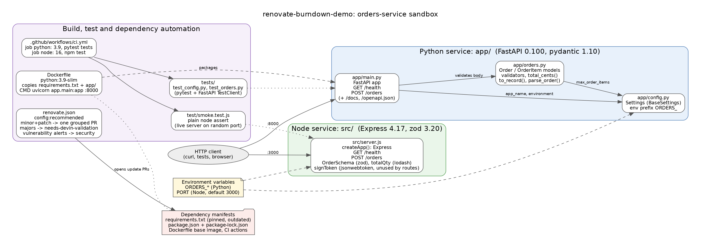

# Architecture

`renovate-burndown-demo` is an orders-service sandbox whose dependencies are pinned to old,
partly vulnerable versions on purpose. [Renovate](https://docs.renovatebot.com/) opens the
update PRs and Devin validates each one. The repo holds two small, independent order services
(Python and Node) that share an API shape, plus the test, container and CI files Renovate updates.

The diagram source is [`diagrams/architecture.dot`](diagrams/architecture.dot) (Graphviz).
After editing it, run `docs/diagrams/render.sh` to regenerate
[`architecture.png`](diagrams/architecture.png) and [`architecture.svg`](diagrams/architecture.svg).

## Components

| Path | What it is |
| --- | --- |
| `app/` | Python order service: FastAPI 0.100 on pydantic 1.10 (v1 API). |
| `src/server.js` | Node order service: Express 4.17 with zod validation. |
| `tests/` | pytest suite for the Python service (models, settings, HTTP via `TestClient`). |
| `test/smoke.test.js` | Node smoke test (plain `assert`, starts the Express app on a random port). |
| `Dockerfile` | Container image for the Python service only. |
| `.github/workflows/ci.yml` | CI: one Python job and one Node job. |
| `renovate.json` | Renovate configuration that drives the update PRs. |
| `requirements.txt`, `package.json`, `package-lock.json` | Pinned dependency manifests Renovate updates. |

The two services do not call each other and have no database, queue or external service.

### Python service (`app/`)

- `app/main.py` creates the FastAPI app titled with `Settings.app_name` and exposes:
  - `GET /health` returns `{"status": "ok", "env": <environment>}`.
  - `POST /orders` validates the body as an `Order` and returns `Order.to_record()`: the order
    as a dict plus `total_cents`. FastAPI also serves `/docs`, `/redoc` and `/openapi.json`.
- `app/orders.py` holds the pydantic v1 models:
  - `OrderItem(sku, quantity, unit_price_cents)`: `sku` must be non-empty upper-case,
    `quantity` must be positive.
  - `Order(order_id, customer_email, items)`: `items` must hold 1 to `max_order_items` entries.
    `total_cents()` sums `quantity * unit_price_cents`; `parse_order()` uses `Order.parse_raw`.
  - Validation failures are raised by pydantic while FastAPI parses the body, so they return
    `422` with pydantic's error list.
- `app/config.py` defines `Settings(BaseSettings)`, read from environment variables with the
  case-insensitive prefix `ORDERS_`:

  | Setting | Env var | Default | Used by |
  | --- | --- | --- | --- |
  | `app_name` | `ORDERS_APP_NAME` | `orders-api` | FastAPI title |
  | `environment` | `ORDERS_ENVIRONMENT` | `dev` | `/health` |
  | `max_order_items` | `ORDERS_MAX_ORDER_ITEMS` | `50` (must be >= 1) | `Order` items validator |
  | `database_url` | `ORDERS_DATABASE_URL` | `postgresql://localhost:5432/orders` | not read by any code |
  | `aws_region` | `ORDERS_AWS_REGION` | `us-east-1` | not read by any code |
  | `debug` | `ORDERS_DEBUG` | `false` | not read by any code |

  `get_settings()` builds a new `Settings` on every call, so env changes apply immediately
  (the tests rely on this).

### Node service (`src/server.js`)

- `createApp()` builds an Express app with JSON body parsing and exposes:
  - `GET /health` returns `{"status": "ok"}`.
  - `POST /orders` validates with the zod `OrderSchema` (`orderId` non-empty string, `items`
    of `{sku, qty}` with positive integer `qty`, at least one item). Success returns
    `{orderId, totalQty}` (sum of `qty` via lodash `sumBy`); failure returns `400` with
    `{"error": <zod issues>}`.
- `signToken(payload, secret)` signs an HS256 JWT valid for 1 hour (jsonwebtoken). It is
  exported and tested but not used by any route.
- Run directly (`npm start`), it listens on `PORT` (default `3000`).

The Node API uses camelCase fields and counts quantities only; the Python API uses snake_case
fields and computes prices. They are parallel demos, not one API.

## Dependencies

Most pins are outdated on purpose so Renovate has updates to open. Several packages are
declared but not imported by the service code, which keeps them in the update stream:

| Manifest | Imported by code | Declared only |
| --- | --- | --- |
| `requirements.txt` | `fastapi`, `pydantic`; `pytest`, `httpx` (tests) | `boto3`, `requests`, `urllib3`, `PyYAML`, `cryptography`, `Jinja2` |
| `package.json` | `express`, `lodash`, `zod`, `jsonwebtoken`; `minimist` (test only) | `axios`, `node-fetch`, `tar`, `aws-sdk`, `pg`; devDeps `jest`, `typescript` |

The Node test runs with plain `node`, so `jest` and `typescript` are not used.

## Build and run

- **Container:** the `Dockerfile` starts from `python:3.9-slim`, installs `requirements.txt`,
  copies `app/` and runs `uvicorn app.main:app --host 0.0.0.0 --port 8000`. The Node service
  has no image.
- **CI** (`.github/workflows/ci.yml`, on pushes to `main` and on pull requests):
  - `python` job: `actions/checkout@v3`, `actions/setup-python@v4` with Python 3.9,
    `pip install -r requirements.txt`, `python -m pytest tests -q`.
  - `node` job: `actions/checkout@v3`, `actions/setup-node@v3` with Node 16, `npm install`,
    `npm test`.

## Renovate configuration (`renovate.json`)

- Extends `config:recommended`. Renovate's default managers pick up `requirements.txt`, the
  npm manifests, the `Dockerfile` base image and the GitHub Actions versions in CI.
- `separateMajorMinor: true`; `prConcurrentLimit` and `prHourlyLimit` are `0` (no limits).
- All minor and patch updates are grouped into one `non-major deps` PR (`automerge: false`).
- Major updates get their own PRs labelled `needs-devin-validation`.
- `osvVulnerabilityAlerts` is on; vulnerability PRs get the `security` label and
  `prPriority: 10`.

## Demo flow

1. Renovate scans the manifests and opens PRs: one grouped non-major PR, one PR per major and
   security-labelled PRs for known vulnerabilities.
2. CI runs pytest and the Node smoke test on each PR.
3. Devin validates each PR in parallel (for example the pydantic v2 major, which needs code
   changes in `app/config.py` and `app/orders.py` because they use the v1 `BaseSettings` and
   `validator` APIs).
